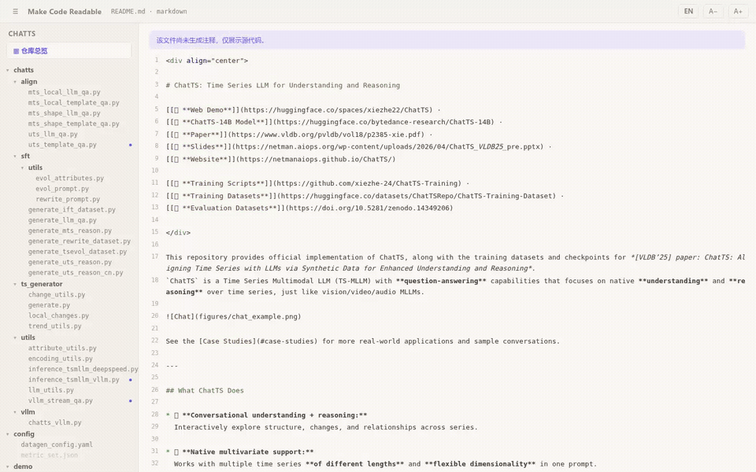

# Make Code Readable

**把任何仓库变成「代码 × 人话」双栏对照的阅读页。**

左栏是 IDE 级源代码，右栏是逐行对应的**自然语言伪代码**（中英双语），配上仓库结构总览和划词即答的 AI 解读。一个自包含 HTML 文件，离线可用，也可本地起服务。



> 示例：真实开源仓库 [NetManAIOps/ChatTS](https://github.com/NetManAIOps/ChatTS)（时间序列多模态 LLM）的阅读效果。

## 为什么

AI 写的代码越来越多，逐行读源码太慢。这个工具让你：

- **像读代码一样读人话** —— 右栏不是评注，是每行代码的自然语言直译，缩进与代码同步；每个非空行都有解释，零省略（校验器强制）
- **先看宏观再钻细节** —— 仓库总览：目录树 + 每个目录/文件的一句话职责，点击直接跳转
- **不懂就划** —— 框选代码，AI 立刻流式解读，无需点击，可多轮追问
- **零依赖、可分享** —— 纯 Python 标准库 + 原生 HTML/JS，导出单个 HTML，双击即开

## 快速开始

### 作为 Agent skill（推荐，无需 API Key）

把本仓库克隆到 skills 目录（如 `~/.agents/skills/make-code-readable`），然后对你的 Agent（Kimi Code、Claude Code 等）说：

> 用 make-code-readable 给这个仓库生成代码阅读页面

Agent 本身就是大模型：它会按 `SKILL.md` 的契约扫描仓库、分批生成双语注释、构建页面——**注释生成全程不需要 API Key**。

### 手动流程

```bash
python3 -m mcr.scan <repo>                                    # 1. 扫描分批（大仓库）
python3 -m mcr.scan <repo> --next                             # 2. 查看下一批待办
#    … 按 SKILL.md 格式生成 .mcr/annotations/*.json 与 .mcr/structure.json …
python3 -m mcr.schema <repo>/.mcr/annotations <repo>          # 3. 校验（缺行/越界/重叠报错）
python3 -m mcr.build <repo> --annotations <repo>/.mcr/annotations --out reader.html
# 4. 双击 reader.html，离线阅读
```

### 划词提问（可选，需 API Key）

```bash
export MCR_API_KEY=sk-...                            # 任何 OpenAI 兼容接口
export MCR_BASE_URL=https://api.minimaxi.com/v1      # 默认值，可改
export MCR_MODEL=minimax-m3.1-flash                  # 默认值，可改
python3 -m mcr.serve <repo> --annotations <repo>/.mcr/annotations --port 8765
# 打开 http://127.0.0.1:8765/ ，框选代码 → 自动流式解读（首 token < 1s）
```

## 功能一览

| | |
|---|---|
| 双栏对照 | 代码行与解释同一 grid 行渲染，永不错位；hover 同步高亮，点击钉住 |
| 自然语言伪代码 | 「若 … → …」「循环 …」直译每行，缩进同步，段落吸顶总结 |
| 仓库总览 | 全目录树 + 宏观职责解析，点击跳转；侧栏为 IDE 式可折叠目录树 |
| 划词即答 | 选中即自动流式解读，大行层面板多轮追问，Markdown 渲染 |
| 中英切换 | 注释双语内嵌，一键瞬时切换 |
| IDE 观感 | 米白背景、Cursor Light+ 语法配色、Cascadia/SF Mono 字体栈、字号可调 |

## 示例

- `examples/reader.html` —— 迷你演示项目（Python + JS），直接打开体验
- `examples/chatts-reader.html` —— 真实仓库 ChatTS 的核心文件注释 + 全仓库结构总览
- `examples/demo-project/`（含 `.mcr/` 注释 JSON）—— 标准注释写法参考

## 原理

```
Agent 读仓库 → mcr.scan 分批 → 逐文件注释 JSON + structure.json（Agent 手写）
     → mcr.schema 校验（每个非空行必须有解释）
     → mcr.build 内联 highlight.js/CSS/JS/数据 → 单文件 HTML
     → （可选）mcr.serve 本地服务 + /api/ask SSE 流式代理到 OpenAI 兼容接口
```

详细契约见 [SKILL.md](SKILL.md)。MIT License。

---

**English**: Make Code Readable turns any repo into a dual-pane reading page — IDE-grade code on the left, line-by-line natural-language pseudocode (Chinese/English) on the right, plus a repo-structure overview and instant streaming AI explanations for any selected code. Ships as an Agent skill (no API key needed for annotations) and builds a single self-contained offline HTML using only the Python standard library. See `SKILL.md` for the annotation contract and `mcr/scan.py` for large-repo batching.
