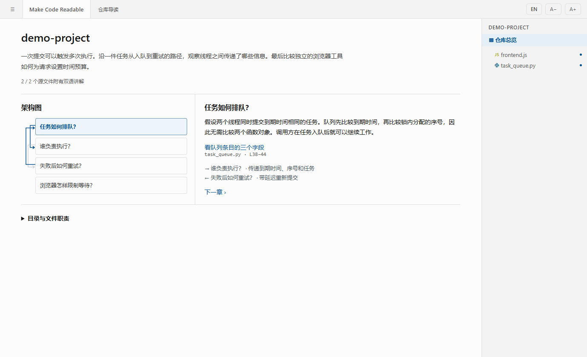
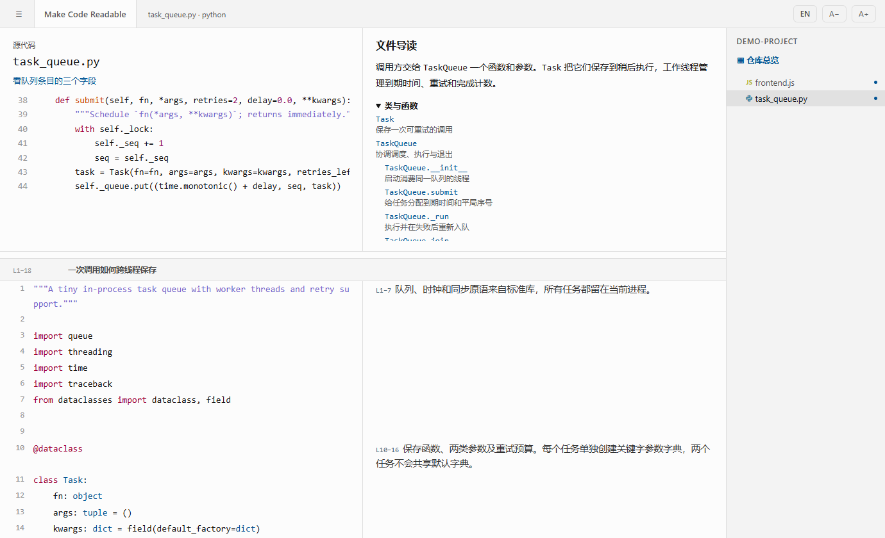

# Make Code Readable

把代码仓库编成一份可以从架构图一路读到实现的双语教程。打开首页，选一个概念，跟随一次具体调用，再点击源码位置检查它如何工作。整个阅读器可以保存为一个离线 HTML。



## 试读

下载 [可直接打开的示例](examples/reader.html)，从“任务如何排队？”开始。跟踪到工作线程后，可以沿异常分支返回提交入口，看看一次失败为什么会产生一个新的队列条目。文件导读列出类和函数的分工；正文让共同完成一个操作的几行代码共享一段解释。点击行号范围可定位并高亮，浏览器后退会回到原章，地址可以收藏。右上角可切换中英文或调整字号。



## 在自己的仓库使用

将本仓库克隆到 Agent 的 skills 目录，然后说“用 make-code-readable 帮我读懂这个项目”。Agent 按 [SKILL.md](SKILL.md) 阅读代码，编写概念、关系和双语注释。生成和离线阅读均无需 API key。

也可以从本工具根目录运行以下命令。

```sh
python -m mcr.scan <repo>
python -m mcr.scan <repo> --next
# 按 SKILL.md 撰写 <repo>/.mcr/structure.json 与 annotations/*.json
python -m mcr.schema <repo>/.mcr/annotations <repo>
python -m mcr.build <repo> --annotations <repo>/.mcr/annotations --out <repo>/reader.html
```

[示例项目](examples/demo-project) 包含 Python 和 JavaScript 源码及全部教程数据。已有的单行注释与目录索引也可用同一命令构建。阅读器按 Cursor Light 的 Windows 编辑器字体、浅灰文件树和语法色设计，使用内嵌 highlight.js 给源码着色。

## 选区追问

设置 `MCR_API_KEY`，按需设置 `MCR_BASE_URL`、`MCR_MODEL`，运行 `python -m mcr.serve <repo> --annotations <dir> --port 8765`。在本地服务页面框选源码即可提问。

The reader turns a repository into an offline Chinese/English tutorial with a clickable architecture map, source-range links, class and function guides, and aligned explanations of implementation decisions. The builder uses the Python standard library. MIT License.
